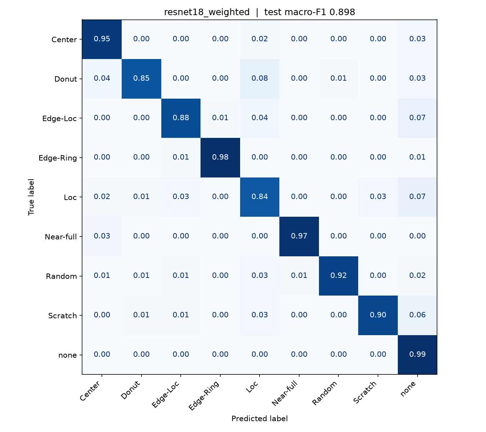
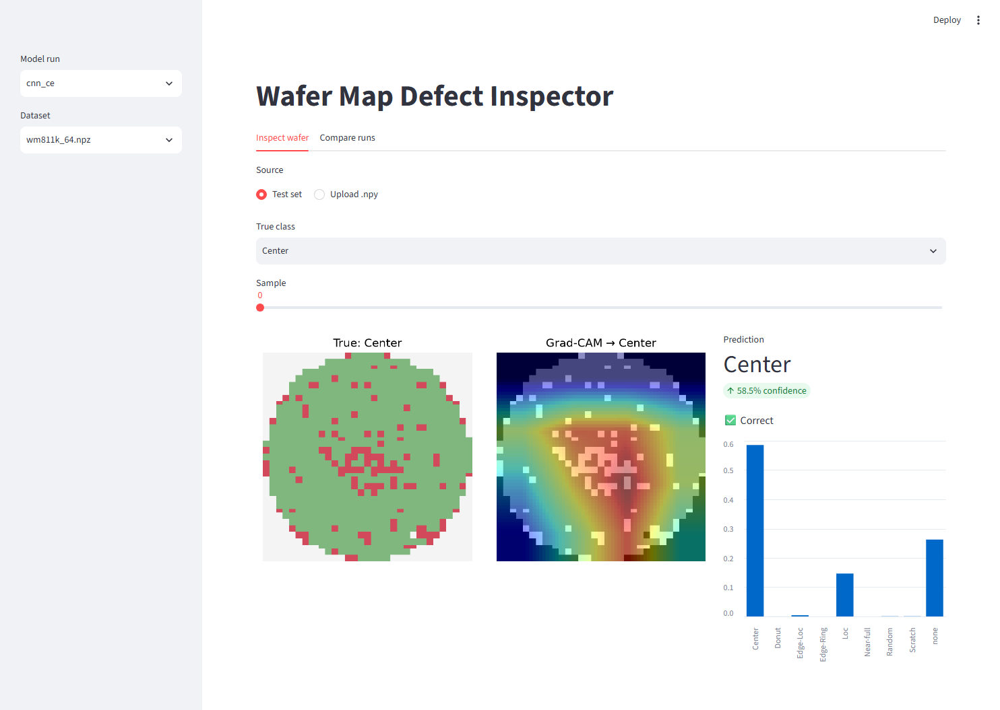
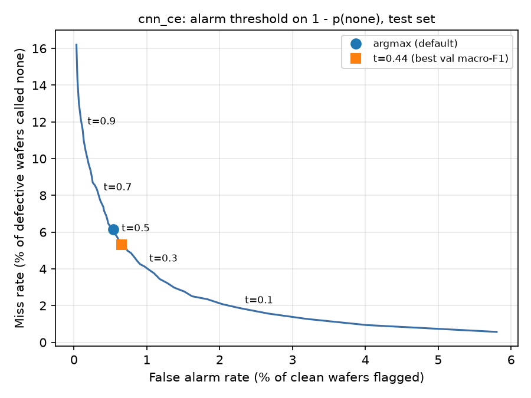
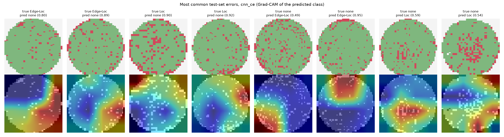
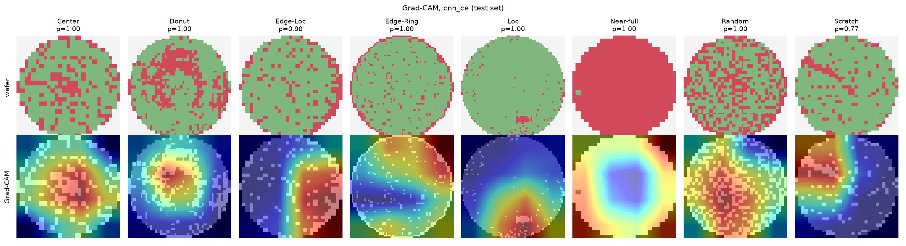

# Wafer Map Defect Classification

[](https://github.com/hawk1ngyang/wafer-defect-classification/actions/workflows/smoke-test.yml)

Classifying wafer-level failure patterns on **WM-811K** — 811K wafer maps from a real semiconductor fab, ~173K of them labeled into 9 classes — with CNNs, under severe class imbalance, with Grad-CAM explanations and an interactive inspection dashboard.

## Why it matters

In a fab, the *spatial pattern* of failing dies on a wafer points to the root cause: an **Edge-Ring** suggests an etch or deposition uniformity issue, a **Scratch** points at wafer handling, a **Center** blob at a CMP or spin-coat problem. Classifying patterns automatically lets yield engineers triage thousands of wafers per day and route them to the right tool owner.

## Data

172,950 labeled wafers:

| Class | Wafers | Share | | Class | Wafers | Share |
|---|---:|---:|---|---|---:|---:|
| none | 147,431 | 85.24% | | Center | 4,294 | 2.48% |
| Edge-Ring | 9,680 | 5.60% | | Scratch | 1,193 | 0.69% |
| Edge-Loc | 5,189 | 3.00% | | Random | 866 | 0.50% |
| Loc | 3,593 | 2.08% | | Donut | 555 | 0.32% |
| | | | | Near-full | 149 | 0.09% |

Wafer maps have variable sizes, so they are resized to 64×64 with nearest-neighbour (keeping die states discrete) and one-hot encoded into 3 channels: off-wafer / pass / fail. Split is stratified 70 / 10 / 20 (train 121,065 / val 17,295 / test 34,590, seed 42).

## Approach

- **Models:** a 4-block baseline CNN, and ResNet-18 with the ImageNet stem replaced for 64×64 inputs
- **Imbalance:** plain CE vs. inverse-sqrt class-weighted CE vs. focal loss
- **Augmentation:** random 90° rotations + flips (defect patterns on a round wafer are rotation-invariant)
- **Selection metric:** macro-F1 on the validation set — accuracy is misleading when 85% of wafers are `none`
- **Explainability:** Grad-CAM on the last conv stage

## Results (test set)

| Run | Val macro-F1 | Test accuracy | Test macro-F1 | Test macro-F1 (defect classes) |
|---|---:|---:|---:|---:|
| cnn_ce (20 ep) | 0.899 | 98.06% | 0.901 | 0.890 |
| cnn_weighted (20 ep) | 0.890 | 97.43% | 0.886 | 0.873 |
| **resnet18_weighted** (30 ep) | **0.908** | 97.82% | 0.898 | 0.887 |
| resnet18_focal (30 ep) | 0.901 | 97.63% | 0.893 | 0.881 |

Each run keeps the epoch with the best validation macro-F1; test numbers are on the held-out 34,590 wafers. **By the selection rule (validation macro-F1) the chosen model is resnet18_weighted**, test macro-F1 0.898. cnn_ce happens to score highest on test, but picking it for that reason would be tuning on the test set. All four runs sit within 0.015 of each other from a single seed each, so the honest reading is:

- **A 10× larger model does not help.** ResNet-18 (11.2M parameters) does not beat the 1.2M-parameter CNN on 64×64 maps.
- **Re-weighting trades precision for recall rather than raising F1.** Class weights / focal loss push rare-class recall up (Scratch 0.82 → 0.90 for the CNN) and precision down (0.85 → 0.71), so macro-F1 stays flat or drops. The alarm-threshold analysis below shows the same trade-off can be set after training.

Per-class test F1:

| Class (test wafers) | cnn_ce | cnn_weighted | resnet18_weighted | resnet18_focal |
|---|---:|---:|---:|---:|
| Center (859) | **0.940** | 0.916 | 0.938 | 0.928 |
| Donut (111) | 0.869 | 0.861 | 0.855 | **0.877** |
| Edge-Loc (1,038) | 0.858 | 0.836 | **0.863** | 0.853 |
| Edge-Ring (1,936) | **0.982** | 0.976 | **0.982** | 0.981 |
| Loc (718) | **0.802** | 0.776 | 0.786 | 0.772 |
| Near-full (30) | 0.933 | 0.933 | **0.936** | 0.921 |
| Random (173) | 0.902 | 0.898 | **0.924** | 0.914 |
| Scratch (239) | **0.833** | 0.792 | 0.811 | 0.807 |
| none (29,486) | **0.992** | 0.989 | 0.991 | 0.990 |

Loc is the hardest class in every run, and its errors are mostly confusion with `none` in both directions: cnn_ce calls 106 Loc wafers `none`; the class-weighted resnet18 instead calls 137 `none` wafers Loc (see the error gallery below). Full reports: `runs/<run>/report.txt`.



### Inference cost (`python scripts/benchmark.py`)

| Model | Parameters | Checkpoint | RTX 4080 Laptop, batch 256 | CPU, batch 256 | CPU, batch 1 |
|---|---:|---:|---:|---:|---:|
| CNN | 1.2 M | 4.7 MB | 22,351 wafers/s | 963 wafers/s | 386 wafers/s |
| ResNet-18 | 11.2 M | 44.8 MB | 3,054 wafers/s | 117 wafers/s | 68 wafers/s |

Even on a laptop CPU the CNN classifies a day of wafers in seconds, so inference cost is not the constraint for deployment.

### Dashboard

`streamlit run app.py` — pick a run, browse test wafers by class or upload a `.npy` map, and see the prediction, class probabilities and Grad-CAM side by side; a second tab compares runs.



### Post-hoc analysis (`python scripts/analyze.py --run runs/<run>`)

No retraining; all numbers on the test set. Thresholds are chosen on the validation set.

| Run | Variant | Accuracy | Macro-F1 | Miss rate | False alarm rate |
|---|---|---:|---:|---:|---:|
| cnn_ce | argmax (default) | 98.06% | 0.901 | 6.15% | 0.54% |
| cnn_ce | + test-time augmentation (8 rotations/flips) | 98.17% | 0.904 | 6.00% | 0.47% |
| cnn_ce | alarm threshold t = 0.44 | 98.06% | 0.901 | 5.33% | 0.65% |
| resnet18_weighted | argmax (default) | 97.82% | 0.898 | 3.51% | 1.26% |
| resnet18_weighted | + test-time augmentation | 97.99% | 0.902 | 3.25% | 1.14% |
| resnet18_weighted | alarm threshold t = 0.74 | 98.12% | **0.905** | 4.80% | 0.72% |

*Miss rate* = defective wafers called `none`; *false alarm rate* = clean wafers flagged as defective. TTA gives a small, free gain on both models (single run, so treat it as indicative). The class-weighted model misses fewer defects but raises more false alarms; raising its threshold to 0.74 (picked on validation) pulls it back toward the unweighted model's operating point and gives the best test macro-F1 of any configuration, 0.905. The threshold is the knob a fab would actually set. For cnn_ce: lowering it trades false alarms for fewer misses along the curve below, e.g. t = 0.1 cuts misses to 1.9% at 2.3% false alarms (macro-F1 0.878).



**Calibration.** Temperature scaling fitted on validation barely changes anything: cnn_ce T = 1.06, test ECE 0.33% → 0.27%; cnn_weighted T = 0.92, ECE 0.33% → 0.30%; resnet18_weighted T = 1.07, ECE 0.39% → 0.28%. The softmax probabilities are already usable as confidences for a review queue. Caveat: ECE is dominated by the 85% of easy `none` wafers, so it says little about calibration on the rare classes.

The most common errors are defect ↔ `none` at the boundary (Edge-Loc → none 122, Loc → none 106, none → Edge-Loc 57, none → Loc 39). Many of these wafers are visually ambiguous — sparse local clusters on an otherwise noisy wafer — which points at label noise as much as model error.



### Grad-CAM

One correctly classified test wafer per defect class (`python scripts/gradcam_gallery.py --run runs/cnn_ce`). The heatmaps land on the defect itself — the centre blob, the ring, the edge cluster, the scratch line — not on wafer-shape artefacts.



## Reproduce

```bash
python -m venv .venv && .venv\Scripts\activate
pip install torch==2.11.0 torchvision==0.26.0 --index-url https://download.pytorch.org/whl/cu128   # or /whl/cpu
pip install -r requirements.txt

# 1. Data (needs a Kaggle API token in ~/.kaggle/access_token)
kaggle datasets download -d qingyi/wm811k-wafer-map -p data/raw --unzip
python -m src.prepare --pkl data/raw/LSWMD.pkl --size 64

# 2. Train
python -m src.train --model cnn --loss ce
python -m src.train --model cnn --loss weighted
python -m src.train --model resnet18 --loss weighted --epochs 30
python -m src.train --model resnet18 --loss focal --epochs 30

# 3. Dashboard
streamlit run app.py
```

Quick CPU smoke test without the real data (results are meaningless):

```bash
python scripts/make_synthetic.py --n 2000
python -m src.train --data data/processed/synthetic_64.npz --epochs 2 --workers 0
```

## Project layout

```
src/data.py       loading LSWMD.pkl, resizing, one-hot, dataset + augmentation
src/prepare.py    pkl -> fixed-size .npz with stratified split
src/models.py     baseline CNN, ResNet-18 for 64x64
src/train.py      training loop, weighted / focal loss, AMP, evaluation + confusion matrix
src/gradcam.py    Grad-CAM
scripts/gradcam_gallery.py   one Grad-CAM example per defect class -> docs/
scripts/analyze.py           TTA, alarm-threshold sweep, error gallery for a trained run
scripts/benchmark.py         inference throughput and model size
tests/                       unit tests (pytest): preprocessing, augmentation, losses, models
app.py            Streamlit dashboard
.github/workflows/smoke-test.yml   CI: synthetic data -> train 1 epoch -> Grad-CAM -> dashboard loads
```
